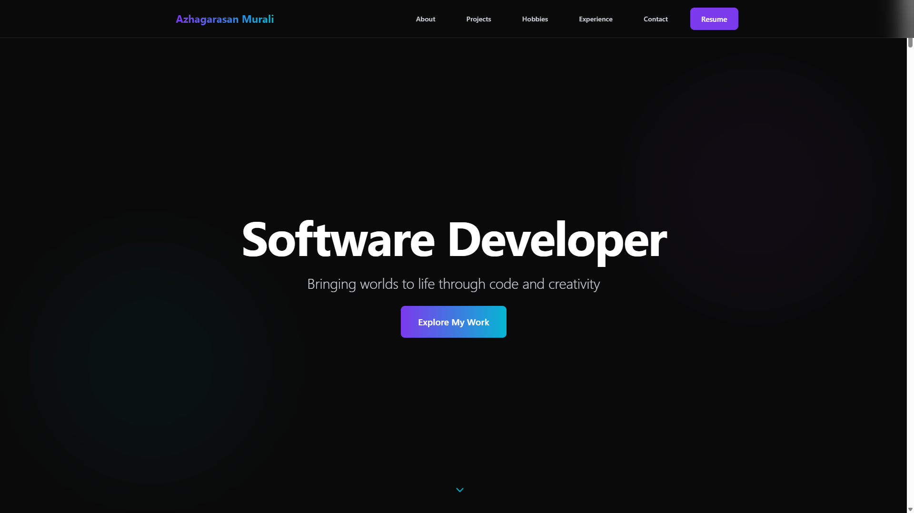

<div align="center">

# Azhagarasan Murali — Portfolio

**Portfolio showcasing game development, Unity engineering, and immersive interactive experiences.**

 ·  ·  ·  ·  ·  · 

[Live Demo](https://azhagarasanmurali.github.io/) · [Repository](https://github.com/azhagarasanmurali/azhagarasanmurali.github.io) · [Featured Projects](#-featured-highlights)

</div>

---

## Preview



---

## Overview

This portfolio is a single-page React application powered by Vite and TypeScript. Sections are lazy-loaded for faster initial paint, critical hero assets are preloaded behind a branded loading screen, and scroll-triggered animations use Intersection Observer for smooth, GPU-friendly motion. The site ships with semantic HTML, viewport and theme-color meta tags, and is deployed automatically to GitHub Pages on every push to `main`.

---

## Features

### Responsive & Accessible Layout

- 📱 Mobile-first design with a collapsible navigation menu and touch-friendly section scrolling
- 🖥️ Full-viewport section layout optimized for desktop and tablet breakpoints
- ♿ Semantic structure, lazy-loaded media, and async image decoding for smoother rendering

### Immersive Dark Theme

- 🌙 Curated dark palette with violet and cyan accent tones tuned for readability
- ✨ Ambient hero effects, glass-style surfaces, and subtle glow accents
- 🎨 Centralized design tokens via Tailwind CSS for consistent spacing and typography

### Interactive Components

- 🎬 Hero section with video/image background and scroll-to-projects CTA
- 📂 Project gallery grouped by organization, with rich detail modals and image lightboxes
- 🕹️ Hobbies section featuring an art gallery marquee and interactive Three.js 3D model viewer
- 📅 Experience timeline with work and education highlights
- ⏳ Branded loading screen with asset preload progress

### Contact & Social Integration

- 📬 Contact section with availability status and embedded social links
- 🔗 One-click links to GitHub, LinkedIn, itch.io, and YouTube
- 📄 Direct resume download from the navigation bar

---

## Featured Highlights

| Project                            | Summary                                                                                                | Stack                                                |
| ---------------------------------- | ------------------------------------------------------------------------------------------------------ | ---------------------------------------------------- |
| **Ultrasonic Immersive Scanner**   | Cross-platform Unity VR simulator replicating ultrasonic immersion testing for safe, hands-on training | Unity, C#, VR, Windows, macOS                        |
| **Starter Template**               | Company-wide Unity starter template with reusable movement, camera, UI, and audio systems              | Unity, C#, SOLID, Scriptable Objects, WebGL, VR      |
| **ToolingU SME Virtual Simulator** | Industrial training simulator with realistic process and equipment workflows                           | Unity, C#, VR, WebGL, Asset Bundles, AWS S3, MongoDB |

Explore all projects on the [live demo](https://azhagarasanmurali.github.io/).

---

## Tech Stack

| Category         | Technologies                                           |
| ---------------- | ------------------------------------------------------ |
| **Core**         | React 19, TypeScript 5.9, Vite 8                       |
| **Styling & UI** | Tailwind CSS 3, PostCSS, Autoprefixer, Lucide React    |
| **3D & Media**   | Three.js, React Three Fiber, React Three Drei          |
| **Tooling**      | ESLint 9, TypeScript ESLint, React Hooks ESLint plugin |
| **Deployment**   | GitHub Actions, GitHub Pages, Node.js 20               |

---

## Getting Started

### Prerequisites

- **Node.js** 20 or later (matches CI deploy workflow)
- **npm** (comes with Node.js)

### Local Development

```bash
git clone https://github.com/azhagarasanmurali/azhagarasanmurali.github.io.git
cd azhagarasanmurali.github.io
npm install
npm run dev
```

Open the URL shown in the terminal (typically `http://localhost:5173`).

### Production Build

```bash
npm run build      # Type-check + Vite production build → dist/
npm run preview    # Preview the production build locally
npm run lint       # Run ESLint across the project
```

### Deployment

Pushes to the `main` branch automatically build and deploy to GitHub Pages via [.github/workflows/deploy.yml](.github/workflows/deploy.yml). No manual deploy step is required once GitHub Pages is enabled for the repository.

---

## Project Structure

| Path                           | Purpose                                                       |
| ------------------------------ | ------------------------------------------------------------- |
| `src/config/portfolio.json`    | All portfolio content and section configuration               |
| `src/App.tsx`                  | Section orchestration, lazy loading, and asset preloading     |
| `src/components/`              | Hero, About, Projects, Hobbies, Timeline, Contact, Navigation |
| `public/assets/`               | Images, videos, documents, and social icons                   |
| `tailwind.config.js`           | Color palette, animations, and responsive tokens              |
| `.github/workflows/deploy.yml` | CI/CD pipeline for GitHub Pages                               |

---

## Links
<div align="center">

[](https://github.com/azhagarasanmurali) [](https://www.linkedin.com/in/azhagarasan-murali/) [](mailto:azhagarasan.azhagu@gmail.com) [](https://azhagarasanmurali.itch.io) [](https://youtube.com/@mr.greenstudio3879)
</div>

---

## License

© 2026 Azhagarasan Murali. **All Rights Reserved.**

This repository is a personal portfolio for viewing purposes only. No permission is granted to copy, modify, distribute, or reuse any part of this project without explicit written consent.

---

Built with React, TypeScript, and Vite · Deployed on GitHub Pages
